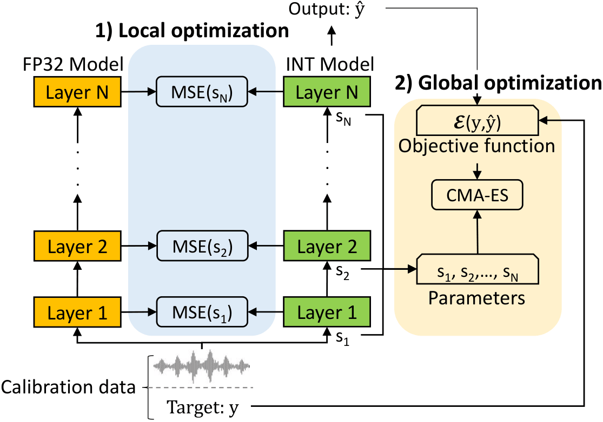
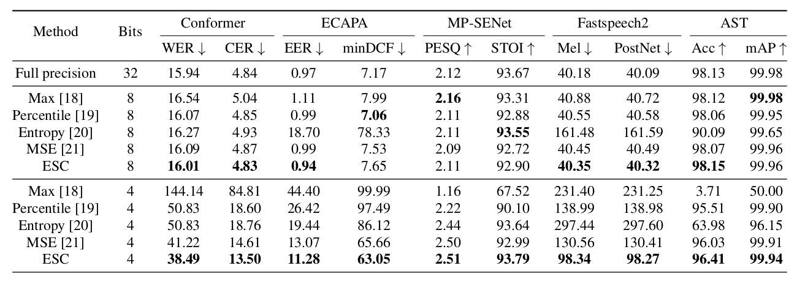

## Evolution Strategy–Based Calibration for Low-Bit Quantization of Speech Models
The official implementation of our paper: Evolution Strategy–Based Calibration for Low-Bit Quantization of Speech Models. The paper is the file esc.pdf

#### Abstract
*Quantization has become essential for the efficient deployment of speech processing systems. Although widely studied, most existing quantization methods were developed for vision and NLP architectures, while the specific challenges of audio signals remain largely overlooked. In particular, we show that audio activations can exhibit large calibration ranges, leading to significant information loss when standard calibration techniques are applied.
To address this, we propose ESC, an Evolution Strategy–based Calibration method that formulates activation scaling as an optimization problem and solves it using a two-step local–global scheme driven by an evolution strategy.
ESC enables unaltered performance under full INT8 quantization and is the first calibration method to achieve near-lossless performance for full INT4 quantization across multiple speech tasks. Integrating ESC with PTQ methods further reduces performance loss, achieving a 1% relative accuracy degradation on the AST model.*



### Datasets

Please refer to the original GitHub model code for instructions on setting up the dataset.  

- [LibriSpeech](https://github.com/LuluW8071/Conformer.git)
- [VoxCeleb](https://github.com/TaoRuijie/ECAPA-TDNN.git)
- [VoiceBank-DEMAND](https://github.com/yxlu-0102/MP-SENet)
- [LJSpeech](https://github.com/ming024/FastSpeech2)
- [Speech Commands V2](https://github.com/YuanGongND/ast)

### Environnement setup

Use the following code to create a venv and install the required dependencies

```
   python3 -m venv venv
   source venv/bin/activate
   pip install -r requirements.txt
```

### ESC Calibration

Use this code to use ESC calibration with default parameters with AST model on 4 bits

```
   python inference.py --model ast --num_bits 4 --calib mse --esc
```

If you want to add PTQ, for example Smoothquant (example of script for each ptq is present in benchmark.sh)

```
   python inference.py --model ast --num_bits 4 --calib mse --esc --ptq smoothquant
```

### ESC evaluation

The calibration step can be skipped by using a manually saved scale dictionary or the ones provided in the scale folder. For AST evaluation after ESC, use the following code.

```
   python inference.py --model ast --num_bits 4 --precompute_scale scale/ast_b4_esc.pkl
```

Note that the results for Conformer and ECAPA differ slightly from those reported in the paper due to minor architecture modifications required for TorchScript export.

### Export

The quantized model can then be exported and benchmarked to an NVIDIA device by first tracing it with TorchScript and then compiling it with TensorRT using the following code.

```
   python inference.py --model ast --num_bits 4 --calib mse --esc --export --fp32_eval
```

### Results

   


### Acknowledgement

Part of the code is highly inspired from [Pytorch_quantization](https://docs.nvidia.com/deeplearning/tensorrt/archives/tensorrt-861/pytorch-quantization-toolkit/docs/index.html) repo.